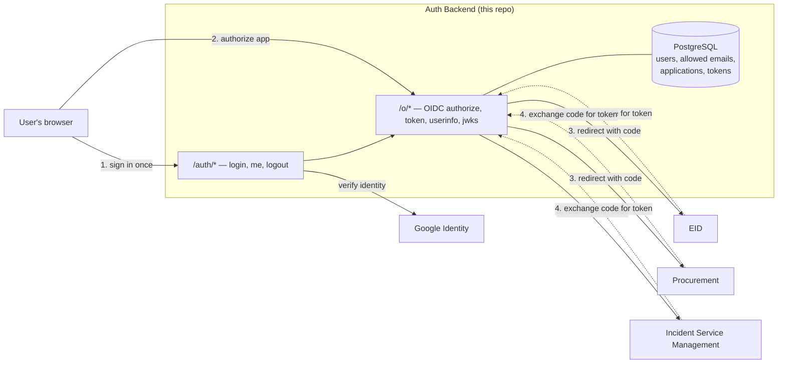
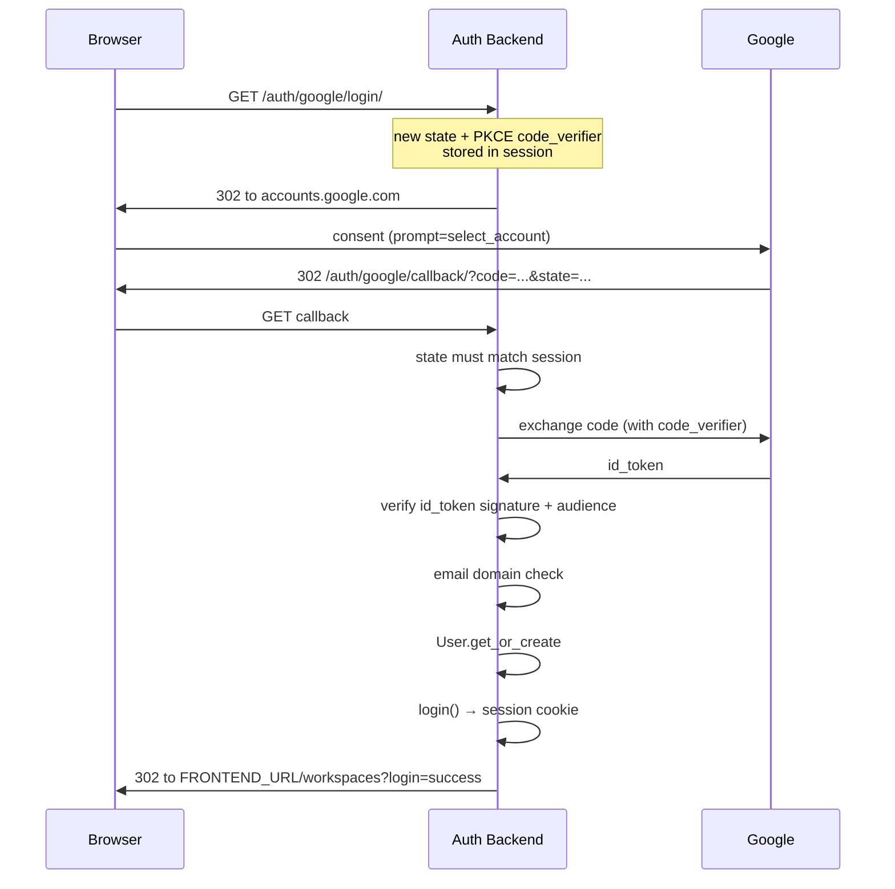
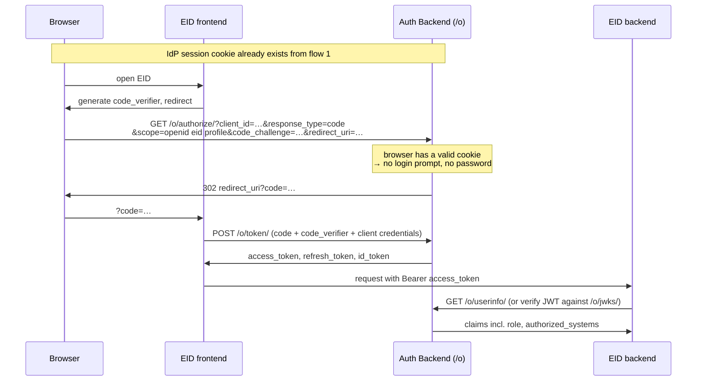

# GreenHill Central Authentication Backend

The identity provider (IdP) for the three GreenHill Academy systems. A user signs
in **once** here and can then open any system their account is authorised for,
without signing in again.

- **EID** — Executive Intelligence Dashboard (`eid` scope)
- **Procurement Management System** — PMS (`procurement` scope)
- **Incident Service Management** — ISMP (`incident` scope)

This service is *only* the identity provider. It does not host the three systems
and it does not render their UI. Each system is an OAuth 2.0 **relying party**
that sends the user here to authenticate and then validates the token it gets back.

> **This document is the living description of the system.** It is updated at the
> end of every implementation step so it always describes what the code actually
> does — including the parts that are still missing.

---

## Current status

| Area | State |
| --- | --- |
| Access policy (`AllowedEmail`, `access.py`) | Working — verified |
| GreenHill email policy (`domain_guard.py`) | Working — format enforced on both login paths |
| Google OAuth 2.0 / OIDC *login to this service* | Working |
| Email + password login (throttled) | Working |
| OIDC **provider** settings (lifetimes, PKCE, RFC 9700) | Hardened |
| Custom ID/access-token claims (`role`, `authorized_systems`) | Working |
| Identity record (`google_sub`, verified email, unique email) | Working — verified |
| Scope restriction (a user cannot request a system they lack) | **Working** — `validate_scopes` |
| Per-app `Application` rows (EID / PMS / ISMP) | **Working** — `seed_oauth_clients` |
| `next` round-trip after Google | **Working** |
| Session manager (list / revoke active sessions) | **Working** — `/auth/sessions/` |
| Logout that propagates to all three systems | **Working** — token revocation + RP-initiated logout |
| Redis cache (required for throttling + token revocation at scale) | Optional — set `REDIS_URL` |
| Transport security (HSTS, SSL redirect) | Env-gated — off locally, on in production |

Test suite: **191 tests, all passing** (`python manage.py test authentication`,
run against SQLite). `manage.py check` clean; `makemigrations --check` reports no
changes.

The suite is **environment-independent**: it produces the same result whether or
not a `.env` file exists, and whatever redirect URIs that file happens to
contain. Any test that needs a variable to be *unset* blanks it explicitly with
`mock.patch.dict(os.environ, {NAME: ""})` rather than relying on it being absent —
otherwise a developer's real `.env` (which ships localhost URIs for all three
relying parties) would silently change the outcome.

All eight SSO steps and the operations work are implemented. See [Roadmap](#roadmap).

---

## Who can sign in

Sign-in is restricted to **GreenHill Academy staff email addresses**, which all share
one domain and one shape:

```
<name>@greenhillacademy.ac.ug      e.g.  cnmusisi@greenhillacademy.ac.ug
```

Only the part **before the `@`** varies. `authentication/domain_guard.py` is the
single definition of that rule:

| Constant / function | Purpose |
| --- | --- |
| `GREENHILL_DOMAIN` | `@greenhillacademy.ac.ug` |
| `GREENHILL_EMAIL_EXAMPLE` | `cnmusisi@greenhillacademy.ac.ug` — the sample shown in errors and docs |
| `GREENHILL_EMAIL_HINT` | One-line user-facing reminder of the rule |
| `is_greenhill_email(email)` | Is this address on our domain at all? |
| `is_valid_greenhill_email(email)` | Domain **and** local part match the convention |
| `validate_greenhill_email(email)` | Returns the normalised address, or raises `ValidationError` with `code` `required` / `wrong_domain` / `bad_format` |

The local part is `[a-z][a-z0-9]*(?:[._-][a-z0-9]+)*` — it must start with a
letter, may contain digits, and may use `.`, `_` or `-` **between** name parts.
`firstname.lastname` is the convention staff actually use, but `cnmusisi`,
`mary.k.achebe` and `jdoe2` are all accepted; `+aliases`, leading digits, doubled
separators and trailing separators are not.

The same address is the **identity key** for authorisation:

* A user may sign in with any number of login methods (Google, password) — all of
  them resolve to the same `auth.User` because the email is normalised and unique.
* Whether that user may open EID, Procurement or Incident is decided by the
  `AllowedEmail` row for that email address. No row → they can authenticate and see
  an empty dashboard, but they cannot open any system.

In practice: **the email is the account, and the `AllowedEmail` row is the
permission.**

The password path rejects anything that is not a well-formed GreenHill address
before it even looks up a password, returning `403` with
`{"error": "greenhill_email_format"}` and a human-readable hint.

---

## Architecture at a glance

Two separate sessions exist, and keeping them separate is the whole trick:

1. **The IdP session** — a Django session cookie on *this* domain. It answers one
   question: *"is this browser already signed in to GreenHill?"* It lives as long
   as `SESSION_COOKIE_AGE` (8 hours) or until the browser closes, depending on
   "remember me".
2. **Per-system sessions** — each of EID/PMS/ISMP holds its own token or its own
   cookie. This service never reads another app's session.



Because the IdP cookie already exists after step 1, step 2 for the second and
third systems requires **no credentials** — that is the single sign-on.

---

## Flows

### 1. Signing in to the identity provider (Google)

This is how the IdP session gets created. It is *this service's* own login, not
the SSO grant.



Failure paths redirect to the frontend with an `error` query parameter rather
than showing a Django error page:

| Condition | Result |
| --- | --- |
| `state` missing from session, or does not match `?state=` | `400` |
| PKCE verifier missing from session | `400` |
| Code exchange fails | `400` |
| `id_token` verification fails | `400` |
| `email` is not `@greenhillacademy.ac.ug` | redirect `/?error=greenhill_account_required` |
| `email_verified` is not `true` | redirect `/?error=email_not_verified` |
| `hd` present but not `greenhillacademy.ac.ug` | redirect `/?error=wrong_hosted_domain` |
| Google subject is already bound to another account | redirect `/?error=identity_conflict` |
| Account exists but `is_active=False` | redirect `/?error=account_inactive` |

The one-time `google_oauth_state` and `google_code_verifier` are popped from the
session on success so they cannot be replayed.

### 2. Signing in with email + password

`POST /auth/login/` — an alternative to Google for accounts that have a Django
password set.

```json
{ "email": "someone@greenhillacademy.ac.ug", "password": "…", "remember": true }
```

- Throttled to **10 requests per minute** per client (`LoginRateThrottle`).
- `remember: false` calls `set_expiry(0)`, so the session dies when the browser closes.
- Errors are returned as `{authenticated: false, error: <code>, fields: {email, password}}`
  so the form can highlight the offending field.
- A non-GreenHill email is rejected **before** the password is checked (`403`).

### 3. How another system (e.g. EID) gets access — the actual SSO

This is standard OIDC **authorization code + PKCE**. EID is the client here.



**Key point:** the IdP cookie is what makes step 3 passwordless. If that cookie is
absent or expired, `/o/authorize/` sends the browser to a login page instead —
which is exactly why `LOGIN_URL` and a `next` round-trip still need wiring up
(see roadmap, step 4).

Each relying party must be registered as an `Application` row in Django admin
before `/o/authorize/` will accept it. Those rows do not exist yet.

---

## Access policy

There is exactly **one** place that decides what a person may access:
`authentication/access.py`. No view, no validator, and no test may hardcode a role
or an email address.

The policy itself is data, stored in the `AllowedEmail` table and edited through
Django admin:

| Field | Meaning |
| --- | --- |
| `email` | Lower-cased, unique. The identity. |
| `role` | `CEO` / `Manager` / `Staff`. Cosmetic + claims. |
| `authorized_systems` | JSON list of `AllowedEmail.System` values |
| `is_active` | Set `False` to block sign-in without deleting the record |

`AllowedEmail.System` values are **exact strings** and must be typed verbatim:

| Constant | Stored value | Scope granted |
| --- | --- | --- |
| `System.EID` | `EID` | `eid` |
| `System.PROCUREMENT` | `Procurement` | `procurement` |
| `System.INCIDENT` | `Incident Service Management` | `incident` |

> ⚠️ `"Incident"` alone is **not** a valid value. The stored string is the full
> `"Incident Service Management"`.

Two functions are exported:

```python
get_user_access(email)   # -> {"role": ..., "authorized_systems": [...]}
get_granted_scopes(email)  # -> {"eid", "procurement", "incident"} (subset)
```

**There is no CEO fallback.** An email with no `AllowedEmail` row — or an inactive
one — gets `role: "Greenhill User"` and an empty system list. It can authenticate
but cannot open any system. This is deliberate: access must be granted explicitly.

`/auth/me/` re-reads the policy on every request instead of trusting the role and
system list cached in the session, so revoking access in admin takes effect
immediately without forcing a re-login.

---

## Data model

| Model | Purpose |
| --- | --- |
| `auth.User` (Django built-in) | Identity record. `username` is set to the email on creation. |
| `GoogleIdentity` | The verified Google account behind a user: `google_sub` (unique), `email_verified`, `hosted_domain`, `google_email`. |
| `AllowedEmail` | The access policy (see above). |
| `UserSession` | One row per signed-in **browser**, so a user can list and kill their own devices. |
| `oauth2_provider.Application` | One row per relying party (EID, PMS, ISMP) — created by `seed_oauth_clients`. |
| `oauth2_provider.Grant` | A user's consent for a client + scope set. |
| `oauth2_provider.AccessToken` / `RefreshToken` / `IDToken` | Issued tokens. |
| `django.contrib.sessions.models.Session` | The actual server-side session data. Deleting a row here signs that browser out instantly. |

### Two layers of session

| Layer | Where | Lifetime | What it answers |
| --- | --- | --- | --- |
| **IdP session** | `django_session` + `sessionid` cookie on the auth domain | `SESSION_COOKIE_AGE` (8 h default) | "Is this browser already signed in to GreenHill?" |
| **Per-app session/token** | EID, PMS, ISMP — their own cookie or stored JWT | `ACCESS_TOKEN_EXPIRE_SECONDS` (1 h) + refresh | "May this request act as this user here?" |

`SESSION_ENGINE` is `django.contrib.sessions.backends.db` on purpose. The cookie and
cached backends keep session *data* in the browser, which would make "revoke this
device" meaningless — there would be nothing server-side to delete. With the
database backend, revoking is a `DELETE` and the browser's cookie stops resolving
on its very next request.

`UserSession` is a **thin index** over `django_session`, not a second source of
truth:

* It is written by `UserSessionMiddleware` *after* the response, so the key stored
  is the final one even when the view called `login()` (which cycles the key).
* `last_seen_at` is refreshed at most once per `SESSION_TOUCH_INTERVAL` seconds,
  so browsing does not cause a write per request.
* A tracking failure is logged and swallowed — a missing device row, never a 500.
* Rows are never trusted for authentication. Deleting the matching `django_session`
  row is what actually signs a browser out; the inventory row is stamped
  `revoked_at` so the UI can explain what happened.

`manage.py prune_expired` revokes inventory rows whose `django_session` row has
gone (expired naturally) and calls `cleartokens` / `clearsessions`. Schedule it.

### Global logout

`POST /auth/logout/` and `POST /auth/logout-everywhere/` both go through
`_end_session()`:

1. Work out who the session belongs to (session data, not `request.user`, because
   the logout views opt out of DRF authentication).
2. Delete the `django_session` row(s) — this browser only, or every session.
3. Delete the user's `oauth2_provider.AccessToken` and `RefreshToken` rows, so an
   app holding a live token stops working immediately instead of after an hour.
4. `logout(request)` and report counts of what was destroyed.

Step 3 is what makes logout *global*: without it the three systems would keep
accepting the token they already hold until it expired.

### Email is the identity key

`auth.User.email` is not unique in Django, so two rows could share an address and
one person could sign in as another. Because swapping in a custom user model would
require resetting the database, migration `0006` instead creates a **functional
partial unique index** directly on the table:

```sql
CREATE UNIQUE INDEX auth_user_email_lower_uniq
ON auth_user (LOWER(email))
WHERE email <> '' AND email IS NOT NULL;
```

* `LOWER(email)` makes `Alice@x` and `alice@x` the same identity.
* The `WHERE` clause keeps the many blank-email rows Django allows legal, so
  staff-only accounts still work.
* The migration checks for existing duplicates first and aborts with a readable
  list rather than failing on a raw `IntegrityError`.

### Google's `sub` is the binding

An email address can be reassigned; the OpenID Connect `sub` claim cannot.
`GoogleIdentity` stores it once per user and resolution always goes **`sub` first**:

| Situation | Result |
| --- | --- |
| Unknown `sub` | Find the user by email, or create one, then bind the `sub`. |
| Known `sub`, same email | Sign in as that user. |
| Known `sub`, email changed in Google | Same user; the stored email follows the rename, unless the new address belongs to another account. |
| Known `sub`, new address taken | Refused (`identity_conflict`) — never a silent merge. |

Resolution happens *before* any account is created, so a refused sign-in never
leaves a stray `auth.User` row behind.


This is why the database is PostgreSQL and not Firebase: the OAuth toolkit stores
tokens in normalised SQL tables and joins across them. Firestore/RTDB cannot serve
those queries without rewriting the provider.

---

## Endpoints

### Application endpoints (`/auth/`)

| Method | Path | Purpose |
| --- | --- | --- |
| `GET` | `/auth/google/login/` | Begin Google OAuth (or `/o/authorize/` if already signed in). Accepts `?next=`. |
| `GET` | `/auth/google/callback/` | Google redirect target. Establishes the session, then resumes `next`. |
| `POST` | `/auth/login/` | Email + password login (throttled 10/min). Accepts `?next=`. |
| `GET` | `/auth/me/` | Current user + freshly computed access. `401` if anonymous. |
| `GET` | `/auth/csrf/` | Sets the `csrftoken` cookie. Call before any `POST`. |
| `POST` | `/auth/logout/` | Ends **this** browser's session and revokes its tokens. |
| `POST` | `/auth/logout-everywhere/` | Ends **every** session for the user and revokes all tokens. |
| `GET` | `/auth/logout-redirect/` | Same as logout, then redirects to the frontend sign-in page. |
| `GET` | `/auth/sessions/` | The session manager list. Marks the current browser. |
| `POST` | `/auth/sessions/<id>/revoke/` | Kill one session — only if it belongs to the caller. |
| `POST` | `/auth/sessions/revoke-others/` | Kill every session except the one making the call. |
| `POST` | `/auth/sessions/revoke-all/` | Kill every session including this one. |

Both sign-out endpoints answer with the same shape, so the frontend can show
"we ended 2 sessions and revoked 1 token" instead of guessing:

```json
{
  "authenticated": false,
  "message": "You have been signed out successfully.",
  "sessions_revoked": 1,
  "access_tokens_revoked": 1,
  "refresh_tokens_revoked": 1
}
```

A session row looks like:

```json
{
  "id": 12,
  "ip_address": "102.68.77.14",
  "user_agent": "Mozilla/5.0 (Windows NT 10.0; Win64; x64) …",
  "created_at": "2026-10-30T05:41:11Z",
  "last_seen_at": "2026-10-30T09:12:03Z",
  "is_current": false,
  "is_active": true
}
```

> `revoke-others` is the "sign out everywhere else" button users expect after
> changing a password. `revoke-all` is the panic button. Both return how many
> sessions, access tokens and refresh tokens were destroyed.

### OIDC provider endpoints (`/o/`) — provided by django-oauth-toolkit

| Path | Purpose |
| --- | --- |
| `/o/authorize/` | Authorization endpoint (the SSO entry point for other apps). |
| `/o/token/` | Code → token exchange, refresh. |
| `/o/userinfo/` | Standard OIDC claims for a bearer token. |
| `/o/revoke_token/` | Token revocation. |
| `/o/introspect/` | Token introspection (server-to-server). |
| `/o/jwks/` | Public keys for local JWT verification. |
| `/o/.well-known/openid-configuration/` | Discovery document. |

### Other

| Path | Purpose |
| --- | --- |
| `/` | Redirects to `/api/docs/` |
| `/admin/` | Django admin — where `AllowedEmail` and `Application` rows are managed |
| `/api/docs/` | Swagger UI |
| `/api/schema/` | OpenAPI schema |

> `/auth/me/` is for this service's own frontend only. The three systems must
> never call it: they are relying parties and must validate a **token**, not read
> the IdP session.

---

## Consuming this IdP from another service

This is what EID, Procurement and Incident each have to do. The same recipe works
for any new system.

**1. Discover the provider.** `GET {OIDC_ISS_ENDPOINT}/.well-known/openid-configuration/`
returns every endpoint. Point a standards-compliant OIDC client at the issuer URL
and it will find the rest:

```
https://greenhill-auth-backend2.onrender.com/o
```

**2. Send the user to the authorization endpoint.** With PKCE (required here):

```
GET /o/authorize/?response_type=code
                  &client_id=<EID_CLIENT_ID>
                  &redirect_uri=<registered uri>
                  &scope=openid profile email eid
                  &state=<opaque>
                  &code_challenge=<S256 challenge>
                  &code_challenge_method=S256
```

If the browser has no IdP session, `LOGIN_URL` sends it to Google and then **back
to this URL** — that is the single sign-on. If it already has one, the grant
happens with no prompt at all.

**3. Exchange the code** at `POST /o/token/` with the client id + secret and the
PKCE verifier. You get an `access_token`, a `refresh_token` and an `id_token`.

**4. Use the token.** Either call `GET /o/userinfo/` with
`Authorization: Bearer <access_token>`, **or** validate the JWT yourself against
`GET /o/jwks/`. The self-validating path is what EID uses — no per-request call to
the IdP.

**5. Trust exactly these claims:**

| Claim | Source | Use |
| --- | --- | --- |
| `sub` | user id | The only stable identifier. Never key on email. |
| `email` | `AllowedEmail` / Google | Display, and cross-referencing. |
| `name`, `given_name`, `family_name` | User record | Display. |
| `preferred_username` | local part of the email | Display. |
| `role` | `AllowedEmail.role` | `CEO` / `Manager` / `Staff` / `Greenhill User`. |
| `authorized_systems` | `AllowedEmail.authorized_systems` | The list *this* user holds. |
| `scope` | granted scopes | Contains this app's project scope if the user holds it. |

**6. Never read the IdP cookie.** The `sessionid` cookie is scoped to the auth
domain and is this service's business only. A relying party that reads it would
break the moment the three apps move to different hosts, and it would let a stale
cookie impersonate a user. Tokens only.

**7. When the user signs out,** send the browser to the `end_session_endpoint`
from the discovery document (RP-initiated logout) or simply to
`{FRONTEND_URL}/…` after calling `POST /auth/logout/` on this service. Revoking the
tokens is what actually cuts access.

> **Consequence worth knowing:** because scope enforcement is per user, an app that
> asks for a scope the user does not hold gets **no token at all** — the
> authorization request is rejected. That is intentional: it turns "this person
> should not be in Procurement" into a clean failure instead of a dashboard full of
> 403s.

---

## Configuration

### Creating `.env` — one command

`.env.example` is a **blank form**: it is committed to git, so every value in it
is empty on purpose. `config/settings.py` does not contain secrets either — it
only reads them from the environment. Nothing is "stored" anywhere until you
generate it.

```powershell
python generate_env.py
```

That copies `.env.example` to `.env` and fills in the two values a machine has
to invent:

| Value | How it is produced |
| --- | --- |
| `SECRET_KEY` | `django.core.management.utils.get_random_secret_key()` — 50 chars |
| `OIDC_RSA_PRIVATE_KEY` | fresh 2048-bit RSA key, written in the double-quoted multi-line form python-dotenv requires |

It refuses to overwrite an existing `.env`, because rotating
`OIDC_RSA_PRIVATE_KEY` invalidates every token the provider has ever issued and
breaks the JWKS the three apps cache. `--force` exists for the day you actually
want that.

Two things stay blank, because they cannot be generated locally:

```powershell
python manage.py seed_oauth_clients          # prints each client secret ONCE
```

plus `GOOGLE_CLIENT_ID` / `GOOGLE_CLIENT_SECRET` from
[console.cloud.google.com/apis/credentials](https://console.cloud.google.com/apis/credentials).
The authorised redirect URI there must match `GOOGLE_REDIRECT_URI` exactly.

By hand, the same two values are:

```powershell
# SECRET_KEY
python -c "from django.core.management.utils import get_random_secret_key as k; print(k())"

# OIDC_RSA_PRIVATE_KEY
openssl genrsa -out oidc.pem 2048
```

### Environment variables

| Variable | Required | Notes |
| --- | --- | --- |
| `SECRET_KEY` | yes | Django secret. |
| `DEBUG` | no | `"True"` to enable debug. Defaults to false. |
| `ALLOWED_HOSTS` | no | Comma-separated. |
| `DB_NAME`, `DB_USER`, `DB_PASSWORD`, `DB_HOST`, `DB_PORT` | on Render | If `DB_NAME` is unset the app silently falls back to `db.sqlite3`. |
| `GOOGLE_CLIENT_ID` | yes | Google OAuth client. |
| `GOOGLE_CLIENT_SECRET` | yes | Google OAuth client secret. |
| `GOOGLE_REDIRECT_URI` | yes | Must match the Google console exactly. |
| `FRONTEND_URL` | no | Defaults to `http://localhost:5173`. No trailing slash. |
| `OIDC_RSA_PRIVATE_KEY` | yes | PEM private key used to sign id_tokens. |
| `OIDC_ISS_ENDPOINT` | yes | Must be the public `/o` URL, e.g. `https://…/o`. |
| `DJANGO_ENV` | no | `development` relaxes `OAUTHLIB_INSECURE_TRANSPORT` for http. |
| `REDIS_URL` | no | e.g. `redis://127.0.0.1:6379/1`. Unset → per-process LocMem cache. |
| `SESSION_COOKIE_AGE` | no | IdP session lifetime in seconds. Default `28800` (8 h). |
| `SESSION_TOUCH_INTERVAL` | no | Seconds between `last_seen_at` writes. Default `60`. |
| `SECURE_SSL_REDIRECT` | no | `"True"` in production. **Must stay false locally** (no TLS listener). |
| `SECURE_HSTS_SECONDS` | no | `0` locally, `31536000` in production. |
| `EID_CLIENT_ID` / `EID_CLIENT_SECRET` | for EID SSO | Generated once by `seed_oauth_clients`. |
| `EID_REDIRECT_URIS` | for EID SSO | Comma/space separated. Must match exactly. |
| `EID_POST_LOGOUT_REDIRECT_URIS` | no | Where EID lands after RP-initiated logout. |
| `EID_ALLOWED_ORIGINS` | no | CORS origins for the token endpoint. |
| `PROCUREMENT_*` / `INCIDENT_*` | for those systems | Same six variables, different prefix. |

> `SECURE_SSL_REDIRECT=True` locally makes every `http://127.0.0.1` request answer
> `301` to `https://127.0.0.1`, which nothing is listening on. Turn it on only
> after TLS works on the real hostname.

### Trusted origins

`CORS_ALLOWED_ORIGINS` and `CSRF_TRUSTED_ORIGINS` currently list:

```
http://localhost:5173
http://localhost:5174
https://greenhill-auth-frontend2.onrender.com
https://165.232.50.141.sslip.io
https://138.197.193.101
```

Both cookie flags switch with `DEBUG`: `SameSite=Lax` + not secure locally,
`SameSite=None` + `Secure` in production (required because the frontend and
backend are different origins).

> **No trailing slashes.** An origin is a scheme + host + port and nothing else.
> `https://138.197.193.101/` makes `django-cors-headers` raise
> `corsheaders.E014`, and that is a *system check error* — it aborts every
> management command, including `manage.py test` and `manage.py migrate`.
> `config/settings.py` now strips trailing slashes from both lists immediately
> after they are defined, so one stray character can no longer take the
> project down.

---

## Local development

```powershell
python -m venv .venv
.venv\Scripts\Activate.ps1
pip install -r requirements.txt

# Create your local .env from the committed template, then generate a secret:
Copy-Item .env.example .env
python -c "from django.core.management.utils import get_random_secret_key as k; print(k())"
# paste that output as SECRET_KEY= in .env

python manage.py migrate
python manage.py createsuperuser
python manage.py runserver
```

Then open `http://127.0.0.1:8000/api/docs/`.

All runtime dependencies are pinned in `requirements.txt` (including
`django-oauth-toolkit`, which was missing until 2026-10-30).

> **`SECRET_KEY` is mandatory in production.** With `DEBUG=False` and no
> `SECRET_KEY`, the first request that signs a cookie fails with
> `ImproperlyConfigured: The SECRET_KEY setting must not be empty`.
>
> Locally there is a safety net: when `SECRET_KEY` is unset **and** either
> `DEBUG=True` or a `manage.py test` run is in progress, settings fall back to the
> obvious placeholder `dev-insecure-secret-key-greenhill-local-only`. That is why
> the suite and `runserver` work out of the box on a fresh clone.
>
> Never rely on it in production. `.env.example` lists every variable; copy it and
> set a real key:
>
> ```
> SECRET_KEY=<any long random string for local work>
> DEBUG=True
> ```

### Provisioning a GreenHill staff member

A person needs **two** things: an account (`auth.User`) and permission
(`AllowedEmail`). Creating the account is what a first sign-in does; granting
permission is what an administrator does.

The command that does it:

```powershell
python manage.py grant_access cnmusisi@greenhillacademy.ac.ug
python manage.py grant_access cnmusisi@greenhillacademy.ac.ug --role manager --systems eid,procurement
python manage.py grant_access cnmusisi@greenhillacademy.ac.ug --role manager --systems eid procurement
python manage.py grant_access cnmusisi@greenhillacademy.ac.ug --role manager --systems eid --systems procurement
python manage.py grant_access cnmusisi@greenhillacademy.ac.ug --systems              # clear all access
python manage.py grant_access cnmusisi@greenhillacademy.ac.ug --revoke      # block sign-in, keep the record
python manage.py grant_access cnmusisi@greenhillacademy.ac.ug --activate    # re-enable
python manage.py grant_access --list                                        # show the policy table
```

* The address **must** be a valid `@greenhillacademy.ac.ug` address — the command
  refuses anything else rather than polluting the table with typos.
* `--role` is `ceo` / `manager` / `staff` (default `staff`).
* `--systems` accepts the short names `eid`, `pms`, `ismp` or the full names
  `procurement` / `incident`. All three spellings above are equivalent: comma
  separated, space separated, or the flag repeated. Omitted entirely → the role
  is set but no system is granted; passed with no values → access is cleared.
* It is idempotent: running it twice updates the same row.

The same thing through the admin UI: **Allowed emails** → add → email, role,
authorized systems, active ✔.

> **What `cnmusisi@greenhillacademy.ac.ug` gets you:** nothing, until a row exists.
> Signing in with a valid GreenHill address that has no `AllowedEmail` row succeeds
> — the person is authenticated — but `role` is `Greenhill User` and
> `authorized_systems` is `[]`, so every relying party will refuse them.

Example — a full provision, from nothing to working SSO:

```powershell
python manage.py grant_access cnmusisi@greenhillacademy.ac.ug --role manager --systems eid
```

Now `cnmusisi` may sign in with Google or with a password, and EID will accept the
`eid` scope for them. Procurement and Incident will not.

### Registering the three applications

```powershell
python manage.py seed_oauth_clients --dry-run   # preview
python manage.py seed_oauth_clients             # create, prints secrets ONCE
python manage.py seed_oauth_clients --rotate-secrets
```

Each relying party is defined in `authentication/clients.py` and reads its
`*_REDIRECT_URIS`, `*_POST_LOGOUT_REDIRECT_URIS` and `*_ALLOWED_ORIGINS` from the
environment. A party with no redirect URIs is skipped with a warning, so you can
configure EID first and add the others later. Paste the printed secrets into your
env — they are hashed in the database and cannot be shown again.

### Tests

```powershell
python manage.py check
python manage.py test authentication
```

The suite creates and destroys its own test database, so it needs no seeded data —
access tests build their own `AllowedEmail` rows.

The repo ships no `.env`. Until you create one, prefix test runs with a throwaway
key:

```powershell
$env:SECRET_KEY='local-test-only'; python manage.py test authentication
```

---

## Repository layout

```
manage.py
requirements.txt
config/
    settings.py            # env loading, DB, CORS/CSRF, cache, sessions,
                           #   transport security, OAUTH2_PROVIDER
    urls.py                # /admin, /auth, /o, /api/docs
authentication/
    models.py              # AllowedEmail, GoogleIdentity, UserSession
    access.py              # THE access policy — single source of truth
    users.py               # email ↔ User ↔ Google subject resolution
    domain_guard.py        # the @greenhillacademy.ac.ug rule
    clients.py             # the three relying parties, from env vars
    sessions.py            # UserSession inventory: track, list, revoke, prune
    tokens.py              # revoke a user's access + refresh tokens
    middleware.py          # throttled last_seen_at upkeep
    views.py               # login/callback/me/logout/sessions/csrf
    oauth_validators.py    # OIDC claims + per-user scope enforcement
    throttles.py           # login rate limit
    urls.py, admin.py
    management/commands/
        seed_oauth_clients.py   # create/rotate the three Applications
        grant_access.py         # provision an AllowedEmail row
        prune_expired.py        # cleartokens + clearsessions + stale sessions
    tests.py, test_*.py
    migrations/
```

---

## Security notes and known gaps

Recorded here so they are not forgotten. Several are scheduled work, not
oversights.

1. ~~**`validate_scopes()` is not overridden.**~~ **Fixed** — 
   `GreenHillOAuth2Validator.validate_scopes` now calls `split_requested_scopes()`
   and rejects a grant that asks for a system the user does not hold. Anonymous
   calls (the token exchange, where no user is in scope) are passed through to the
   toolkit.
2. ~~**Logout only clears the IdP session.**~~ **Fixed** — `sign_out` and
   `sign_out_everywhere` delete the user's `AccessToken`/`RefreshToken` rows, and
   RP-initiated logout is enabled, so all three systems lose access immediately.
3. ~~**No session manager.**~~ **Fixed** — `UserSession` plus `/auth/sessions/`
   (`list`, `revoke`, `revoke-others`, `revoke-all`). Revoking deletes the
   `django_session` row, so that browser is signed out on its next request.
4. **`/auth/login/` and `/auth/logout/` have `authentication_classes([])`**, which
   also bypasses DRF's CSRF enforcement. They are protected only by the session
   cookie's `SameSite` setting. The frontend should call `/auth/csrf/` first and
   send `X-CSRFToken`; tightening this is still open.
5. ~~**No `email_verified` / `hd` check on the Google id_token.**~~ **Fixed** — the
   callback now requires `email_verified == true` and, when Google sends `hd`,
   that it is `greenhillacademy.ac.ug`.
6. ~~**`User.get_or_create(email=…)`** raises `MultipleObjectsReturned`~~ **Fixed**
   — replaced by `users.resolve_google_user()`, which resolves by Google `sub`
   first and is backed by the unique index on `LOWER(email)`.
7. ~~**`domain_guard` uses a string suffix check.**~~ **Fixed** — the domain is
   compared as a whole segment and the local part must match an anchored pattern.
   `x@evilgreenhillacademy.ac.ug`, `+aliases`, subdomains and unicode look-alikes
   are all rejected.
8. **No Redis cache by default.** Throttle counters are per-process unless
   `REDIS_URL` is set. LocMem is fine for one worker; set `REDIS_URL` when running
   more than one.
9. ~~**`migrations/0001`–`0003`** create/reset a test user~~ **Fixed** — all three
   are now no-ops that keep the migration chain intact. `TEST_USER_PASSWORD` is
   never read again; do not set it. Create accounts with `createsuperuser`.
10. ~~**`SECRET_KEY` has no fallback.**~~ **Partly fixed** — `.env.example`
    documents every variable and `.gitignore` covers `.env`. In addition,
    `config/settings.py` falls back to an obvious placeholder
    (`dev-insecure-secret-key-greenhill-local-only`) **only** when `DEBUG=True`
    or a `manage.py test` run is in progress, so a fresh clone and the suite work
    with no `.env`. Production (`DEBUG=False`, no test command) still fails
    loudly if the variable is missing — which is the point.
11. **HSTS and SSL redirect are off by default** so local `http://127.0.0.1` works.
    `check --deploy` reports `security.W004` (`SECURE_HSTS_SECONDS`) and
    `security.W008` (`SECURE_SSL_REDIRECT`) until you set
    `SECURE_SSL_REDIRECT=True` and `SECURE_HSTS_SECONDS=31536000` in production.
    `security.W009` (`SECRET_KEY`) clears itself once a long random key is set.
12. **Tokens are stored in plaintext** (`oauth2_provider.W006`) and accepted in
    the URI query string (`oauth2_provider.W004`). The fixes are the
    `COMPLIANT_BCP_RFC9700_TOKEN_STORAGE` and
    `COMPLIANT_BCP_RFC9700_ACCESS_TOKEN_TRANSPORT` gates, deliberately left off
    until the three frontends are reviewed.
13. **Revocation reaches the IdP first.** `revoke-others` signs the other browsers
    out of the IdP and deletes their tokens, but an app that already holds a valid
    access token in memory will honour it until it expires (at most
    `ACCESS_TOKEN_EXPIRE_SECONDS`, 1 h). Short access-token lifetimes are the
    mitigation; apps must never treat an access token as long-lived.
14. **A trusted-host misconfiguration aborts every command.** `corsheaders.E014`
    fires when a `CORS_ALLOWED_ORIGINS` entry carries a path or trailing slash,
    and a system check error stops `test`, `migrate` and `runserver` alike. Both
    origin lists are now normalised with `rstrip("/")` right after they are
    defined, so the class of mistake is gone rather than merely avoided.

---

## Roadmap

Implementation order agreed for the SSO work, completed in order.

- [x] **1. Access policy** — remove dead custom-JWT code, centralise policy in
      `access.py`, remove the hardcoded CEO fallback.
- [x] **2. Provider hardening + identity record**
  - [x] Token lifetimes and flow hardening in `OAUTH2_PROVIDER`:
        refresh tokens now expire (14 days, were infinite), refresh reuse
        protection on, `ID_TOKEN_EXPIRE_SECONDS` 1 h (was 10 h), PKCE pinned,
        https-only redirect schemes in production, `REQUEST_APPROVAL_PROMPT`
        `auto`, RP-initiated logout enabled, RFC 9700 gates on.
  - [x] Identity record — unique index on `LOWER(email)`, `GoogleIdentity` stores
        `google_sub`, callback requires `email_verified` and `hd`, migrations
        `0001`–`0003` neutralised.
- [x] **3. Register the relying parties** — `clients.py` + `seed_oauth_clients`:
      one confidential `Application` per system, exact redirect URIs, post-logout
      URIs, `skip_authorization`, per-app scopes from the environment.
- [x] **4. `LOGIN_URL` + `next` round-trip** — `/o/authorize/` bounces an
      unauthenticated user through Google and returns them to the grant. The
      target is stored in the session (not the URL) so it cannot be tampered with,
      and validated with `url_has_allowed_host_and_scheme`.
- [x] **5. Scope enforcement** — `validate_scopes()` backed by
      `get_granted_scopes()`, with the requested/allowed split computed in
      `access.split_requested_scopes`.
- [x] **6. Session manager** — `UserSession` model (migration `0007`), throttled
      `last_seen_at` middleware, `list` / `revoke` / `revoke-others` /
      `revoke-all` endpoints, admin page, `prune_expired` command.
- [x] **7. Global logout** — `sign_out` and `sign_out_everywhere` revoke the
      user's access and refresh tokens; RP-initiated logout wired; the three
      systems can also send the browser to `/auth/logout-redirect/`.
- [x] **8. Authorisation on EID** — see [Consuming this IdP from another
      service](#consuming-this-idp-from-another-service); tokens and JWKS only,
      never the IdP cookie.
- [x] **Ops** — optional Redis `CACHES`, `check --deploy` honours env-gated
      HSTS/SSL, `prune_expired` for `cleartokens` + `clearsessions` + stale session
      rows, `.env.example` complete, and tests covering the whole surface.

---

## Changelog

| Date | Change |
| --- | --- |
| 2026-10-31 | **Suite made `.env`-independent.** `test_unconfigured_party_is_skipped_with_a_warning` assumed the two non-EID relying parties had no redirect URIs in the environment. Once a real `.env` existed — which ships `http://localhost:5174/auth/callback` and `http://localhost:5175/auth/callback` — all three parties were configured and the test failed. It now blanks `PROCUREMENT_*` / `INCIDENT_*` explicitly, matching what `test_raises_when_nothing_is_configured` already did. |
| 2026-10-30 | **`.env` bootstrap + clean API docs.** Added `generate_env.py`, which turns `.env.example` into a working `.env` and fills in `SECRET_KEY` and `OIDC_RSA_PRIVATE_KEY`. The session and sign-out endpoints now declare `request=None` and real response serializers, which removes every `drf_spectacular.W002` — `check --deploy` is down from 11 issues to 4, all of them deliberate env-gated ones. `manage.py spectacular --validate` reports 0 warnings, 0 errors. |
| 2026-10-31 | **Steps 3–8 + Ops**: GreenHill email policy enforced on both login paths (`domain_guard.py`, `403 greenhill_email_format`); `clients.py` + `seed_oauth_clients` for the three relying parties; `LOGIN_URL` and a session-stored `next` round trip that survives the Google hop; `validate_scopes()` closing the scope hole; `UserSession` (migration `0007`), throttled tracking middleware, `sessions.py`, `tokens.py` and the four session-manager endpoints; global logout with token revocation, `/auth/logout-everywhere/` and `/auth/logout-redirect/`; `/auth/csrf/`; `grant_access` and `prune_expired` commands; optional Redis cache; `SESSION_COOKIE_AGE` / `SESSION_TOUCH_INTERVAL` / `SECURE_*` env-gated. Five new test modules. |
| 2026-10-30 | `README.md` created as the living description of the system. |
| 2026-10-30 | **Step 2 (part B)**: identity record. Migration `0006` adds a unique functional index on `LOWER(auth_user.email)` (partial, so blank emails stay legal) after checking for duplicates. New `GoogleIdentity` model stores Google's `sub`, `email_verified`, `hd` and last asserted email. `users.py` resolves sign-ins **by `sub` first**, so a renamed Google address keeps the same account and a conflicting one creates nothing. `google_callback` now requires `email_verified` and a GreenHill `hd`. Migrations `0001`–`0003` (the `TEST_USER_PASSWORD` backdoor) are neutralised no-ops. 79 tests pass. |
| 2026-10-30 | Added `.env.example` documenting every variable; flagged that `TEST_USER_PASSWORD` must never be set in production. |
| 2026-10-30 | **Step 2 (part A)**: `OAUTH2_PROVIDER` hardened. Refresh tokens now expire after 14 days (toolkit default: never), `REFRESH_TOKEN_REUSE_PROTECTION` on, `ID_TOKEN_EXPIRE_SECONDS` cut from 10 h to 1 h, `PKCE_REQUIRED` pinned, `ALLOWED_REDIRECT_URI_SCHEMES` https-only outside DEBUG, `REQUEST_APPROVAL_PROMPT` `auto`, RP-initiated logout enabled, four RFC 9700 behaviour gates and four config gates enabled. `check --deploy` now reports 7 issues (down from unknown); 44 tests still pass. |
| 2026-10-30 | Step 1 verified: `manage.py check` clean, **44 tests pass**, CEO row seeded (`CEO` + all three systems → scopes `eid`, `incident`, `procurement`), unlisted email → `Greenhill User` + no systems, mixed-case input normalised. Added `django-oauth-toolkit==3.4.1` to `requirements.txt` (it was missing entirely, which would have broken every fresh deploy). |
| 2026-10-30 | Step 1 complete. Access policy centralised in `access.py`; hardcoded CEO fallback and the `diagnostic_test_user` endpoint removed; 13 dead modules/tests deleted (the unused custom JWT issuer). Access is now table-driven and tests seed `AllowedEmail` explicitly. |
